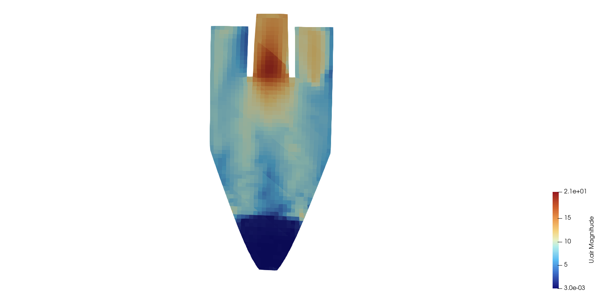

# OpenFOAM-Cyclone-Particle-Tracking
CFD simulation of swirling flow and Lagrangian particle separation using OpenFOAM and ParaView
## Velocity Field Slice (t = 7 s)

Cross-sectional view of the air velocity magnitude (`U.air` in m/s) inside the cyclone separator at `t = 7 s` (simulated using OpenFOAM 12 `foamRun` with coupled Lagrangian particle tracking and post-processed in ParaView). High axial velocity is visible near the central vortex finder/outlet core, while velocity drops substantially toward the lower conical section.

