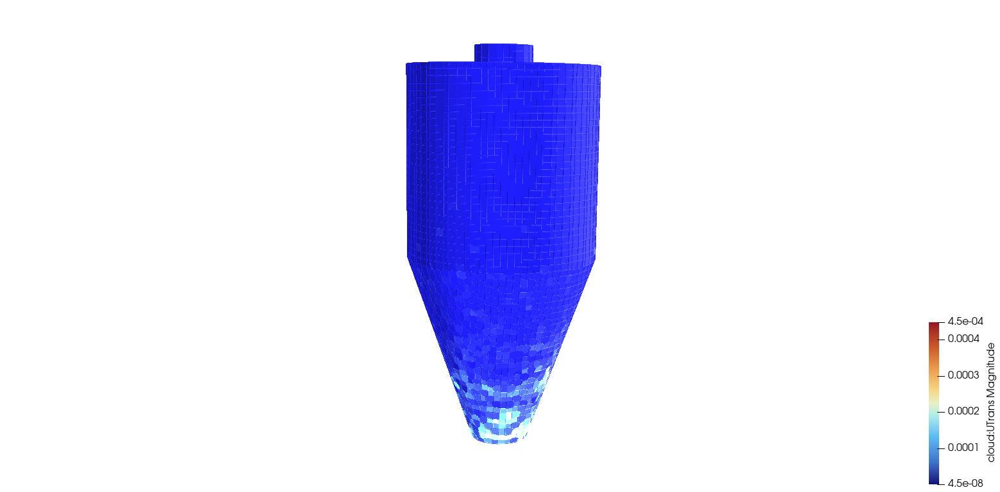
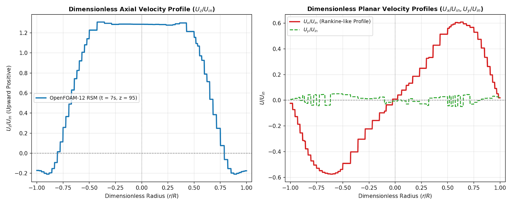

# OpenFOAM-Cyclone-Particle-Tracking
CFD simulation of swirling flow and Lagrangian particle separation using OpenFOAM and ParaView
## Velocity Field Slice (t = 7 s)

Cross-sectional view of the air velocity magnitude (`U.air` in m/s) inside the cyclone separator at `t = 7 s` (simulated using OpenFOAM 12 `foamRun` with coupled Lagrangian particle tracking and post-processed in ParaView). High axial velocity is visible near the central vortex finder/outlet core, while velocity drops substantially toward the lower conical section.

## Lagrangian Cloud Field on Cyclone Surface (`t = 7 s`)

Surface and mesh view (`Surface With Edges`) colored by the Lagrangian `cloud:UTrans` velocity magnitude at `t = 7 s` in ParaView, complementing the internal air velocity slice (`U.air`) above and showing stronger particle transport activity near the lower conical region.

## Dimensionless Velocity Profiles ($z = 95\text{ mm}, t = 7\text{ s}$)

| Hydrodynamic Parameter | OpenFOAM-12 Simulation | Radial Location ($r/R$) |
| :--- | :---: | :---: |
| **Max Positive Swirl Velocity ($U_x / U_{in}$)** | $+0.608$ ($+11.55\text{ m/s}$) | $+0.623$ |
| **Max Negative Swirl Velocity ($U_x / U_{in}$)** | $-0.575$ ($-10.93\text{ m/s}$) | $-0.617$ |
| **Max Upward Axial Velocity ($U_z / U_{in}$)** | $+1.308$ ($+24.85\text{ m/s}$) | $\pm 0.380$ |
| **Locus of Zero Vertical Velocity (LZVV)** | $0.000$ | $\pm 0.789$ |
